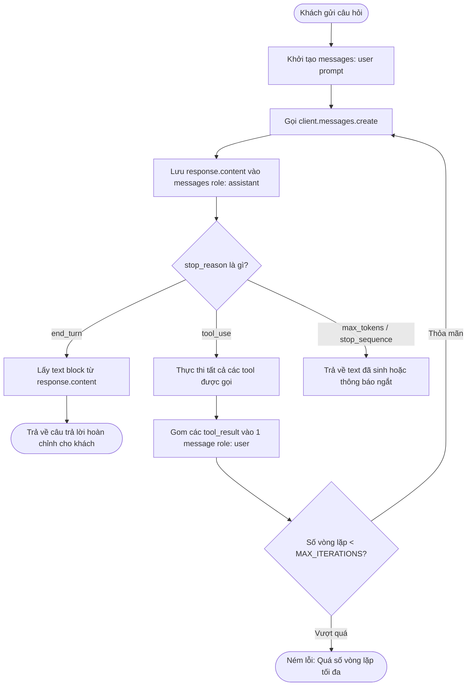

# Báo Cáo Giải Bài Tập 5: Vá Lỗi Agent Trả Lời Cụt Lủn Giữa Chừng

**Học viên:** [FJS-MD6] Professional Backend Development & Optimization  
**Mã bài tập:** `homeworkId: 10218` | `session1-md6/practice5`  
**Mức độ:** Vận dụng cơ bản  

---

## PHẦN 1: CHỈ RA LỖI BẰNG DỮ LIỆU & PHÂN TÍCH NGUYÊN NHÂN GỐC RỄ

Đoạn mã hiện trường trên môi trường staging của ShopFast:
```typescript
// agent.ts - chay duoc, khong loi cu phap, nhung sai logic
async function runAgent(userInput: string) {
  const messages: Anthropic.MessageParam[] = [
    { role: "user", content: userInput },
  ];

  const response = await client.messages.create({
    model: "claude-opus-5",
    max_tokens: 4096,
    tools,
    messages,
  });

  const toolUses = response.content.filter((b) => b.type === "tool_use");

  for (const tool of toolUses) {
    const result = await executeTool(tool.name, tool.input);
    messages.push({
      role: "user",
      content: [
        { type: "tool_result", tool_use_id: tool.id, content: result },
      ],
    });
  }

  const textBlock = response.content.find((b) => b.type === "text");
  return textBlock ? textBlock.text : "";
}
```

Dò theo luồng thực thi (execution flow) của Anthropic Tool Use API, mã nguồn trên mắc phải **2 khiếm khuyết logic cốt lõi**:

---

### Khiếm khuyết 1: Thiếu Vòng Lặp Agent (Missing Agent Execution Loop)

#### 1. Cơ chế lỗi & Phân tích luồng
- Khi khách hàng hỏi thông tin đơn hàng, Model xác định cần gọi công cụ và trả về `stop_reason: "tool_use"`.
- Trong phản hồi đầu tiên này, mảng `response.content` chỉ chứa các block `{ type: "tool_use", id: "...", name: "...", input: {...} }`. Ở bước này, Model **chưa hề sinh câu trả lời ngôn ngữ tự nhiên cuối cùng** cho người dùng (hoặc `text` block rỗng/không có).
- **Lỗi logic:** Hàm `runAgent` chỉ gọi `client.messages.create` đúng **1 lần duy nhất**. Sau khi chạy `executeTool()`, kết quả bị bỏ lửng. Agent không gửi lại dữ liệu này cho Model để Model đọc và diễn đạt thành câu trả lời hoàn chỉnh.
- Dòng cuối cùng: `const textBlock = response.content.find((b) => b.type === "text")` lấy dữ liệu từ chính `response` đầu tiên (vốn không có text khi cần gọi tool) -> `textBlock` là `undefined` -> Hàm trả về chuỗi rỗng `""`.
- Ngược lại, khi khách chỉ chào hỏi ("Xin chào"), Model không gọi tool mà kết thúc ngay với `stop_reason: "end_turn"` và trả về block `type: "text"`. Đó là lý do tại sao *"chào hỏi thì bình thường nhưng hỏi đơn hàng lại im lặng hoặc trả về rỗng"*.

#### 2. Test Case Chứng Minh (Lỗi 1)
| Tiêu chí | Chi tiết thực tế |
| :--- | :--- |
| **Câu hỏi đầu vào (userInput)** | `"Đơn 1024 của tôi đang ở đâu?"` |
| **Hành vi thực tế (Actual)** | Model trả về `stop_reason: "tool_use"`. Tool `check_order_status` được thực thi trong nền nhưng Agent không gửi kết quả lại cho Model. Hàm kết thúc và trả về chuỗi rỗng `""`. |
| **Hành vi mong đợi (Expected)** | Agent phải tiếp tục gửi kết quả tool lại cho Model và đợi Model trả về `stop_reason: "end_turn"`. Kết quả trả về phải là câu trả lời trọn vẹn: *"Đơn hàng #1024 của bạn hiện đang ở Kho Cầu Giấy, Hà Nội và đang được shipper Nguyễn Văn A giao tới bạn (dự kiến trước 18:00)."* |

---

### Khiếm khuyết 2: Vi phạm Cấu trúc Lịch sử Hội thoại của Anthropic API (Missing Assistant Turn)

#### 1. Cơ chế lỗi & Phân tích luồng
- Chuẩn giao thức Anthropic API bắt buộc lịch sử hội thoại phải tuân thủ nghiêm ngặt tính luân phiên của các `role`:
  1. `role: "user"`: Câu hỏi/yêu cầu ban đầu.
  2. `role: "assistant"`: Phản hồi của model chứa quyết định gọi công cụ (các block `tool_use`).
  3. `role: "user"`: Phản hồi chứa kết quả của các công cụ (các block `tool_result`).
- **Lỗi logic:** Trong đoạn code hiện tại:
  ```typescript
  // messages ban đầu: [{ role: "user", content: userInput }]
  for (const tool of toolUses) {
    const result = await executeTool(tool.name, tool.input);
    messages.push({
      role: "user", // <- LỖI: Push trực tiếp lượt user thứ 2 liên tiếp!
      content: [{ type: "tool_result", tool_use_id: tool.id, content: result }],
    });
  }
  ```
  Đoạn code đã **bỏ qua hoàn toàn việc lưu phản hồi của assistant** (`messages.push({ role: "assistant", content: response.content })`).
- **Hậu quả:** 
  1. Hai tin nhắn có `role: "user"` đứng kề nhau mà không có `role: "assistant"` xen giữa.
  2. Block `tool_result` có `tool_use_id` trỏ tới một tool call nhưng trước đó trong lịch sử không hề có lượt nào của assistant chứa `tool_use` với ID đó.
  3. Khi gọi tiếp API ở lượt sau, hệ thống sẽ ném lỗi ngay lập tức: `400 Bad Request - invalid_request_error: messages: roles must alternate between "user" and "assistant"` hoặc `each tool_result block must correspond to a preceding tool_use block`.

#### 2. Test Case Chứng Minh (Lỗi 2)
| Tiêu chí | Chi tiết thực tế |
| :--- | :--- |
| **Thao tác kiểm tra** | Giả định thêm lệnh gọi API thứ hai: `client.messages.create({ messages })` với mảng `messages` do code cũ sinh ra. |
| **Hành vi thực tế (Actual)** | Payload gửi đi: `[ { role: "user", content: "Đơn 1024..." }, { role: "user", content: [tool_result] } ]`. API Anthropic từ chối xử lý và ném ngoại lệ `HTTP 400 Bad Request`. |
| **Hành vi mong đợi (Expected)** | Lịch sử phải có 3 lượt hợp lệ: `[user (câu hỏi)]` -> `[assistant (chứa tool_use)]` -> `[user (chứa tool_results)]`. |

---

### Khiếm khuyết bổ sung (Code Smells cần khắc phục)
1. **Parallel Tool Results bị phân mảnh:** Trong code cũ, mỗi vòng lặp `for (const tool of toolUses)` lại tạo một message `role: "user"` riêng biệt. Chuẩn Anthropic quy định nếu Model gọi nhiều tool song song trong 1 lượt, toàn bộ `tool_result` của lượt đó phải được gộp chung vào một message `role: "user"` duy nhất.
2. **Thiếu Max Iteration Guard:** Vòng lặp Agent cần có giới hạn số lần lặp (`MAX_ITERATIONS = 10`) để ngăn chặn nguy cơ vòng lặp vô hạn gây tiêu tốn tài nguyên và token.

---

## PHẦN 2: THIẾT KẾ GIẢI PHÁP VÒNG LẶP AGENT (AGENT LOOP)

### Sơ đồ luồng thực thi chuẩn (Mermaid Flowchart)


---

## PHẦN 3: SOURCE CODE ĐÃ SỬA (`agent.ts`)

Mã nguồn hoàn chỉnh nằm tại: [agent.ts](file:///D:/code-project/Rikkeiedu/all-practices/session1-md6/practice5/agent.ts).
`agent.ts` đi kèm bộ mô phỏng trực tiếp, chạy độc lập mà không yêu cầu cài đặt thêm dependencies, sẵn sàng test thử với lệnh:
```bash
npx tsx agent.ts
```
