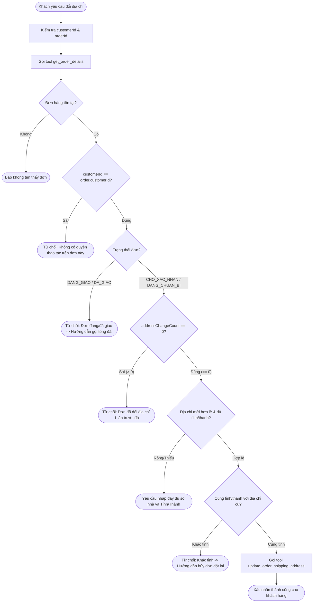

# Báo Cáo Giải Bài Tập 7: Agent Tự Phục Vụ Đổi Địa Chỉ Giao Hàng

**Học viên:** [FJS-MD6] Professional Backend Development & Optimization  
**Mã bài tập:** `homeworkId: 10220` | `session1-md6/practice7`  
**Mức độ:** Vận dụng chuyên sâu  

---

## PHẦN A: BÁO CÁO PHÂN TÍCH VÀ THIẾT KẾ GIẢI PHÁP

### 1. Phân tích bài toán (I/O Analysis)

#### Đầu vào (Input Data)
| Trường dữ liệu | Kiểu dữ liệu | Bắt buộc | Mô tả & Ràng buộc |
| :--- | :--- | :--- | :--- |
| `customerId` | `string` | Có | Mã định danh khách hàng đang đăng nhập/hội thoại (kiểm tra quyền sở hữu đơn hàng). |
| `orderId` | `string` | Có | Mã đơn hàng cần thay đổi địa chỉ nhận hàng. |
| `newAddress` | `object` | Có | Thông tin địa chỉ mới, bao gồm: `province` (Tỉnh/Thành phố), `district` (Quận/Huyện), `street` (Địa chỉ chi tiết). |

#### Đầu ra mong đợi (Expected Output)
- **Nhánh thành công (Success):** Cập nhật địa chỉ trong cơ sở dữ liệu, tăng biến đếm `addressChangeCount` lên 1, trả về thông báo xác nhận kèm chi tiết địa chỉ mới: *"Đã cập nhật địa chỉ giao hàng cho đơn #1024 thành công: [địa chỉ mới]."*
- **Nhánh từ chối theo trạng thái đơn (Rejection - Status):**
  - Trạng thái `DANG_GIAO` hoặc `DA_GIAO`: Từ chối cập nhật và hướng dẫn khách gọi tổng đài 1900-xxxx.
- **Nhánh từ chối khác tỉnh/thành (Rejection - Cross Province):**
  - Khác tỉnh: Thông báo không thể đổi khác tỉnh và hướng dẫn hủy đơn cũ để đặt lại.
- **Nhánh từ chối quá số lần đổi (Rejection - Quota Exceeded):**
  - Đã đổi 1 lần (`addressChangeCount >= 1`): Từ chối với lý do mỗi đơn chỉ được hỗ trợ đổi tối đa 1 lần.
- **Nhánh từ chối bẫy dữ liệu & bảo mật (Validation & Security):**
  - Địa chỉ rỗng / khoảng trắng / thiếu tên tỉnh: Yêu cầu cung cấp đầy đủ thông tin địa chỉ chi tiết và tỉnh/thành.
  - `customerId` không trùng khớp với chủ đơn: Báo lỗi quyền truy cập, từ chối cung cấp và chỉnh sửa thông tin.

---

### 2. Đề xuất giải pháp & Bộ Tool tối thiểu đủ dùng
Hệ thống thiết kế theo kiến trúc **Least Privilege** với đúng 2 Tool:
1. **Tool 1 (Chỉ đọc - Read-only): `get_order_details`**
   - *Mục đích:* Tra cứu trạng thái đơn, chủ sở hữu, địa chỉ hiện tại và số lần đã đổi địa chỉ.
   - *Tham số:* `orderId`
2. **Tool 2 (Ghi dữ liệu - Write-only): `update_order_shipping_address`**
   - *Mục đích:* Cập nhật địa chỉ mới vào database sau khi đã vượt qua toàn bộ các lớp kiểm tra nghiệp vụ.
   - *Tham số:* `orderId`, `customerId`, `newAddress`

---

### 3. Thiết kế các bước thực hiện (Sơ đồ luồng Mermaid)

---

## PHẦN B: TRIỂN KHAI VÀ CHỐNG LỖI

Toàn bộ logic đã được triển khai trong file mã nguồn `addressAgent.ts` với các rào chắn kiên cố:
1. **Chặn địa chỉ rỗng / khoảng trắng:** Kiểm tra chuỗi sau khi `.trim()`, yêu cầu độ dài tối thiểu và bắt buộc có trường `province`.
2. **Bảo vệ quyền sở hữu (Multi-tenant Security):** Xác thực `customerId` trước khi cho phép gọi tool ghi dữ liệu.
3. **Phản hồi thân thiện:** Mọi trường hợp từ chối đều giải thích nguyên nhân rõ ràng và đề xuất giải pháp tiếp theo cho khách (hướng dẫn gọi tổng đài hoặc hủy đơn).
