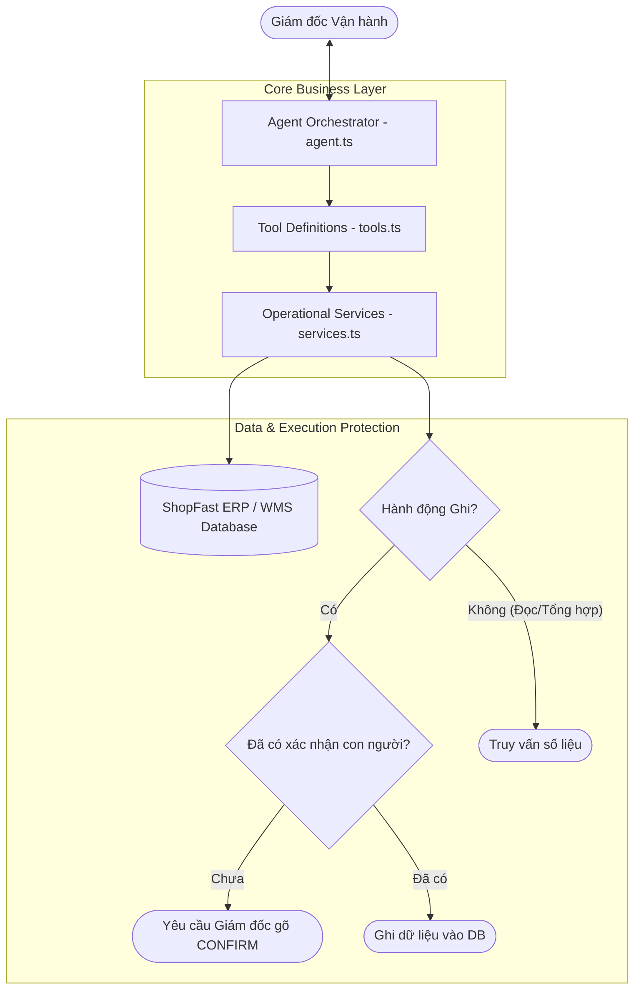

# Báo Cáo Giải Bài Tập 9: Trợ Lý Vận Hành ShopFast (Sáng Tạo)

**Học viên:** [FJS-MD6] Professional Backend Development & Optimization  
**Mã bài tập:** `homeworkId: 10222` | `session1-md6/practice9`  
**Mức độ:** Sáng tạo  

---

## 1. BẢN ĐẶC TẢ THU HẸP BÀI TOÁN (SCOPE SPECIFICATION)

Từ nhu cầu mở của Giám đốc Vận hành: *"Buổi sáng tôi mất một tiếng để biết đêm qua có gì bất thường. Tôi muốn hỏi một câu là ra vấn đề, và nếu cần thì xử lý luôn."*

Hệ thống được thu hẹp và cụ thể hóa thành **3 tình huống vận hành cốt lõi**:
1. **Tình huống 1 - Bất thường đơn hàng ca đêm (Nightly Outlier Detection):**
   - Giám đốc hỏi: *"Đêm qua có vấn đề gì bất thường về đơn hàng không?"*
   - Agent tự động tổng hợp số liệu ca đêm (22h00 - 06h00): tổng đơn, doanh thu, và phát hiện tỷ lệ hủy đơn tăng đột biến (> 15%) hoặc đơn kẹt trạng thái chờ xuất kho.
2. **Tình huống 2 - Cảnh báo khủng hoảng tồn kho (Stockout / Anomaly Alert):**
   - Giám đốc hỏi: *"Kho hàng có mặt hàng nào bị cháy hàng hoặc âm kho đêm qua không?"*
   - Agent truy vấn các SKU có lượng bán tăng đột biến trong đêm dẫn đến hết hàng hoặc tồn kho dưới ngưỡng an toàn (Safety Stock).
3. **Tình huống 3 - Hành động khắc phục khẩn cấp (Emergency Remediation with HITL):**
   - Giám đốc yêu cầu: *"Chuyển 50 đơn kẹt ở kho Bắc Ninh sang đơn vị giao hàng GHTK ngay."*
   - Agent lập kế hoạch điều phối, tạo phiếu thao tác nhưng **bắt buộc dừng lại yêu cầu con người xác nhận (Human-in-the-Loop)** trước khi thực thi lệnh ghi dữ liệu vào database.

---

## 2. THIẾT KẾ KIẾN TRÚC THEO CHUẨN CLEAN CODE

### Sơ đồ phân tầng kiến trúc (Architecture Layers)

### Bảng đặc tả 4 Tool nghiệp vụ:
| Tên Tool | Loại thao tác | Mục đích nghiệp vụ | Tham số đầu vào | Dữ liệu đầu ra |
| :--- | :--- | :--- | :--- | :--- |
| **`get_nightly_metrics_summary`** | Tổng hợp số liệu (Read/Aggregate) | Tổng hợp đơn hàng ca đêm, tỷ lệ hủy, cảnh báo lệch chuẩn | `shiftDate` (string, YYYY-MM-DD) | Báo cáo KPI, % hủy, tỷ lệ hoàn tất |
| **`detect_inventory_anomalies`** | Tra cứu (Read-only) | Quét danh sách các sản phẩm hết hàng hoặc tồn kho nguy cấp | `threshold` (number, mặc định: 10) | Danh sách SKU, tên SP, số lượng tồn |
| **`list_flagged_delayed_orders`** | Tra cứu (Read-only) | Lọc danh sách các đơn hàng bị nghẽn ca đêm chưa thể giao | `warehouseId` (string) | Danh sách orderId, thời gian chờ |
| **`execute_operational_action`** | Ghi dữ liệu (Write-critical) | Thực thi hành động khắc phục: đổi shipper, tạo lệnh nhập kho | `actionType`, `targetIds`, `confirmedByHuman` | Kết quả cập nhật database |

---

## 3. CẤU TRÚC MÃ NGUỒN HOÀN CHỈNH
Thư mục bài tập được chia thành 3 file độc lập theo nguyên tắc tách biệt trách nhiệm (Separation of Concerns):
- `tools.ts`: Khai báo lược đồ JSON Schema của 4 công cụ.
- `services.ts`: Logic nghiệp vụ, database giả lập và cơ chế bảo vệ HITL.
- `agent.ts`: Vòng điều phối Agent với giới hạn `MAX_ITERATIONS = 8` và xử lý ngoại lệ câu hỏi rỗng/vô nghĩa.
