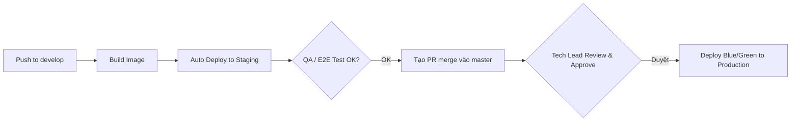

# Báo Cáo Giải Bài Tập 7 (Session 6): Pipeline Nhiều Môi Trường Cho ShopFast

**Học viên:** [FJS-MD6] Professional Backend Development & Optimization  
**Mã bài tập:** `homeworkId: 10245` | `session6-md6/practice7`  
**Mức độ:** Vận dụng chuyên sâu  

---

## 1. THIẾT KẾ QUY TRÌNH PHÂN NHÁNH VÀ TRIỂN KHAI ĐA MÔI TRƯỜNG

1. **Môi trường Staging (Tự động 100%):** Mỗi khi merge vào nhánh `develop`, pipeline tự động build và deploy lên Staging để QA kiểm thử.
2. **Môi trường Production (Manual Approval Gate):** Chỉ kích hoạt khi merge vào nhánh `master`. Bắt buộc phải có xác nhận thủ công từ Tech Lead / Release Manager trên giao diện GitHub Actions mới được kích hoạt deploy.
